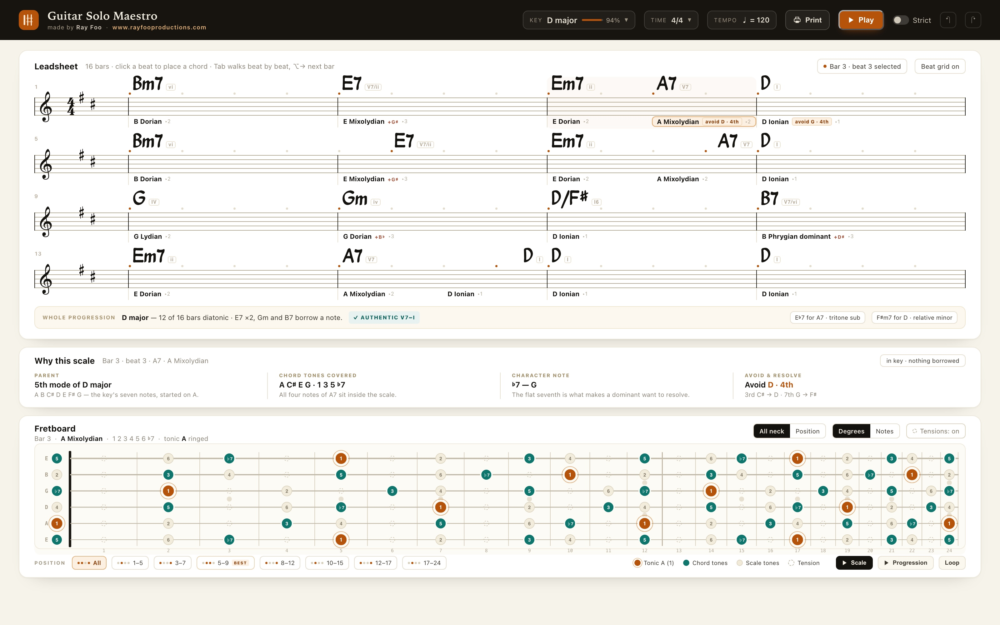

# Guitar Solo Maestro

A practice companion for guitarists who want to solo over chord changes. You give it a
tune; it tells you **which scale to play over every chord** and shows you **where those
notes sit on the neck** — then plays the progression back so you can practise against it.

**v0.4.0** · [Play it live](https://rayfoolshs.github.io/guitar-solo-maestro/) · made by
Ray Foo · [www.rayfooproductions.com](https://www.rayfooproductions.com)



---

## The core idea

Most practice tools stop at backing tracks. This one pairs the track with the theory: every
chord gets a ranked chord-scale, labelled with *why* — "G Phrygian dominant · 5th mode of C
harmonic minor · adds B" — and the fretboard shows the tonic ringed, chord tones in teal and
passing notes muted.

## What you can do with it

**Enter a chart**

A leadsheet with chords above a stave and scale suggestions beneath. Click any beat to type
a chord (`B♭maj7`, `F#m7b5`, `C6/9`, `D/F#`), or drag across the chart to set an A–B loop.
Bars go from 4 to 32; the stepper hides and reveals them without destroying anything. The app
opens on **Blue Bossa** in C minor — two choruses, three flats on the stave.

**Read the analysis**

- Key detection across all 24 keys, with a confidence score and an overridable key.
- A scale per chord, ranked by fit, with borrowed-note flags and transition arrows showing
  how far each scale is from its neighbour.
- One whole-progression recommendation, plus pentatonic and blues alternatives.

**See it on the neck**

A 24-fret fretboard with true fret spacing — tonic ringed in amber, chord tones teal, other
scale tones sand, tensions dashed. Degree or note labels, and eight position windows
(All, 1–5 … 17–24).

**Play it**

A General MIDI soundfont (GeneralUser GS, through Spessasynth's WASM synth) renders piano
comping, a bass line on the roots with chromatic approaches, and drums for **Jazz Swing**,
**Rock** or **Bossa Nova** — a real 3-2 son clave for bossa, the six-hit ride for swing, with
a 0–100 % swing slider. Tempo, count-in, loop, and a compact mixer with per-part volume,
mutes and a piano octave shifter.

**Print it**

A4 landscape, one page, mirroring the on-screen leadsheet: title block, eight bars per
system, scale lane under each.

## Run it

```bash
npm install
npm run dev      # http://localhost:5173
npm run build    # typecheck + production bundle in dist/
npm test         # theory / arrangement tests (16)
```

## How it's built

React + TypeScript on Vite. The musical core — chord parsing, key detection, chord-scale
ranking, groove generation — is **pure TypeScript with no React and no audio**, covered by
unit tests. Playback is a lookahead scheduler over Web Audio. Deployed to GitHub Pages from
a public repo on every push.

```
src/
  theory/     pitch, chords, scales, keys, chord-scale ranking, fretboard mapping
  chart/      the document: Chart / Bar / ChordSlot, Blue Bossa default
  arrange/    chart + style -> note events (comping, bass, drums, swing)
  audio/      lookahead scheduler, built-in synth, Spessasynth soundfont
  ui/         Header, Leadsheet, Mixer, Fretboard, VersionModal
  version.ts  version + release history (drives the in-app modal)
tests/        theory + arrangement tests
```

## What it isn't (yet)

No melody entry, no rhythm notation, one key per chart (so Blue Bossa's D♭ bridge is flagged
as interchange rather than a modulation), and no phone-specific layout. Those are the next
items in [`BUILD_PLAN.md`](BUILD_PLAN.md).

## Docs

- [`BUILD_PLAN.md`](BUILD_PLAN.md) — architecture, theory engine, arrangement, roadmap
- [`CHANGELOG.md`](CHANGELOG.md) — version history

## Deployment

- Source: <https://github.com/rayfoolshs/guitar-solo-maestro>
- Live: <https://rayfoolshs.github.io/guitar-solo-maestro/>

Pushes to `main` run tests, build, and deploy to GitHub Pages via
`.github/workflows/deploy.yml`. The bundle uses a relative base, so it runs from any
sub-path.

## Credits

- Notation glyphs: **Bravura** (Steinberg, SIL OFL)
- Chord lettering: **MuseJazzText** (MuseScore, SIL OFL)
- Soundfont: **GeneralUser GS** by S. Christian Collins
- Synth: **spessasynth_lib** (Apache-2.0)
- Default tune: *Blue Bossa* by Kenny Dorham (chord changes only)
