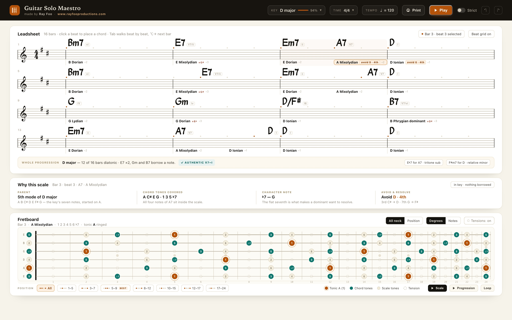

# Guitar Solo Maestro

A practice companion for guitarists who want to solo over chord changes. You give it a
tune; it tells you **which scale to play over every chord** and shows you **where those
notes sit on the neck** — then plays the progression back so you can practise against it.

**v0.10.0** · [Play it live](https://rayfoolshs.github.io/guitar-solo-maestro/) · made by
Ray Foo · [www.rayfooproductions.com](https://www.rayfooproductions.com)



---

## The core idea

Most practice tools stop at backing tracks. This one pairs the track with the theory: every
chord gets a ranked chord-scale, labelled with *why* — "G Phrygian dominant · 5th mode of C
harmonic minor · adds B" — and the fretboard shows the tonic ringed, chord tones in teal and
passing notes muted.

## What you can do with it

**Enter a chart**

A leadsheet with chords above a stave and scale suggestions beneath. Click any beat to type
a chord (`B♭maj7`, `F#m7b5`, `C6/9`, `D/F#`), or drag across the chart to set an A–B loop.
Bars go from 4 to 64; the stepper hides and reveals them without destroying anything. The app
opens on **Blue Bossa** in C minor — two choruses, three flats on the stave. The `Chart ▾`
menu also loads **Autumn Leaves**, **Cantaloupe Island**, **Mr. P.C.** and **Misty**, and the
**Standards** button opens a bundled **Core 100** library with search and style/tag filters.
Transpose the whole chart from the mixer in semitone steps, or pick a key from the header to
move it into that key; click the mixer offset to reset.

**Save and load**

The **Charts** button opens **My charts**: snapshot the working chart, then update, rename,
duplicate, reload or delete saved versions. Back up or share any chart as a versioned
`.gsm.json` file with **Export JSON**, and restore one with **Import JSON**. Saved charts
live in this browser's local storage; the working chart still autosaves separately.

**Take it elsewhere**

`Chart ▾ → Export MIDI…` writes a format-1 `.mid` of the current arrangement — separate
piano, bass and drums tracks, with tempo, meter and swing baked in — ready for a DAW or
notation app.

**Read the analysis**

- Key detection across all 24 keys, with a confidence score and a key selector that
  transposes the whole chart into the key you pick.
- The bar you select is explained in a line under the Leadsheet heading: the chord, its
  scale, the mode it comes from and the notes it borrows.
- A scale per chord, ranked by fit, with borrowed-note flags and transition arrows showing
  how far each scale is from its neighbour.
- One whole-progression recommendation, plus pentatonic and blues alternatives.

**See it on the neck**

A 24-fret fretboard with true fret spacing, oriented the way the neck looks in playing
position — low E on the bottom row up to high E on top. Tonic ringed in amber, chord tones
teal, other scale tones sand, tensions dashed. Degree or note labels, and eight position
windows (All, 1–5 … 17–24).

**See it on the keyboard**

Toggle **Keyboard** to swap the fretboard for a piano view: three octaves of the suggested
scale on a grand stave (bass and treble clefs) with right-hand fingering, plus three octaves
of keyboard with the scale, chord tones and tonic highlighted. Connect a MIDI keyboard and
pick **Piano**, **Organ**, **Flute** or **Saxophone** (defaults to piano); the keys light up
as you play.

**Play it**

A General MIDI soundfont (GeneralUser GS, through Spessasynth's WASM synth) renders piano
comping — voice-led rootless voicings with per-style comping cycles — a bass line on the
roots with chromatic approaches, and drums in six feels:
**Jazz Swing**, **Jazz Ballad**, **Blues Shuffle**, **Rock**, **Funk** and **Bossa Nova**
— a real 3-2 son clave for bossa, 16th hats for funk, brushed swing for the ballad, and the
six-hit ride for jazz. Swing is adjustable for the two jazz feels; the shuffle is a fixed
12/8 feel. Switching style, swing, key or tempo while playing re-arranges from the next
bar. There is also a 0–100 % swing slider, tempo, count-in, loop, and a compact mixer with
per-part volume, mutes and a piano octave shifter. The keyboard view also plays a live
MIDI keyboard through the same soundfont, with a piano/organ/flute/saxophone choice.

**Print it**

A4 landscape, one page, mirroring the on-screen leadsheet: title block, eight bars per
system, scale lane under each.

## Run it

```bash
npm install
npm run dev      # http://localhost:5173
npm run build    # typecheck + production bundle in dist/
npm test         # theory / arrangement / style / standards / io / midi / keyboard / transpose tests (103)
```

## How it's built

React + TypeScript on Vite. The musical core — chord parsing, key detection, chord-scale
ranking, groove generation — is **pure TypeScript with no React and no audio**, covered by
unit tests. Playback is a lookahead scheduler over Web Audio. Deployed to GitHub Pages from
a public repo on every push.

```
src/
  theory/     pitch, chords, scales, keys, chord-scale ranking, fretboard and keyboard mapping
  chart/      the document: Chart / Bar / ChordSlot, Core 100 standards, JSON io, saved-chart library
  arrange/    style descriptors, chart + style -> note events (comping, bass, drums, swing)
  audio/      lookahead scheduler, built-in synth, Spessasynth soundfont, Web MIDI input
  ui/         Header, Leadsheet, Mixer, Fretboard, Keyboard, MidiBar, StandardsModal, ChartsModal, VersionModal
  version.ts  version + release history (drives the in-app modal)
tests/        theory + arrangement tests
```

## What it isn't (yet)

No melody entry, no rhythm notation, one key per chart (so Blue Bossa's D♭ bridge is flagged
as interchange rather than a modulation), and no phone-specific layout. Those are the next
items in [`BUILD_PLAN.md`](BUILD_PLAN.md).

## Docs

- [`docs/`](docs/README.md) — user guide, visual theme, architecture, Core 100, chart format, MIDI export
- [`BUILD_PLAN.md`](BUILD_PLAN.md) — architecture, theory engine, arrangement, roadmap
- [`CHANGELOG.md`](CHANGELOG.md) — version history
- [`UPDATES.md`](UPDATES.md) — upcoming milestones

## Deployment

- Source: <https://github.com/rayfoolshs/guitar-solo-maestro>
- Live: <https://rayfoolshs.github.io/guitar-solo-maestro/>

Pushes to `main` run tests, build, and deploy to GitHub Pages via
`.github/workflows/deploy.yml`. The bundle uses a relative base, so it runs from any
sub-path.

## Credits

- Notation glyphs: **Bravura** (Steinberg, SIL OFL)
- Chord lettering: **MuseJazzText** (MuseScore, SIL OFL)
- Soundfont: **GeneralUser GS** by S. Christian Collins
- Synth: **spessasynth_lib** (Apache-2.0)
- Default tune: *Blue Bossa* by Kenny Dorham (chord changes only)
